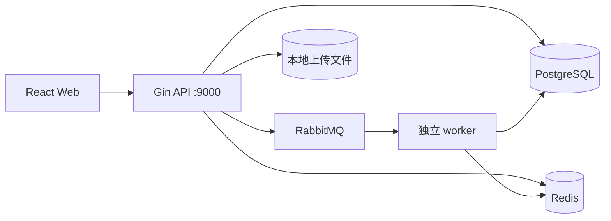
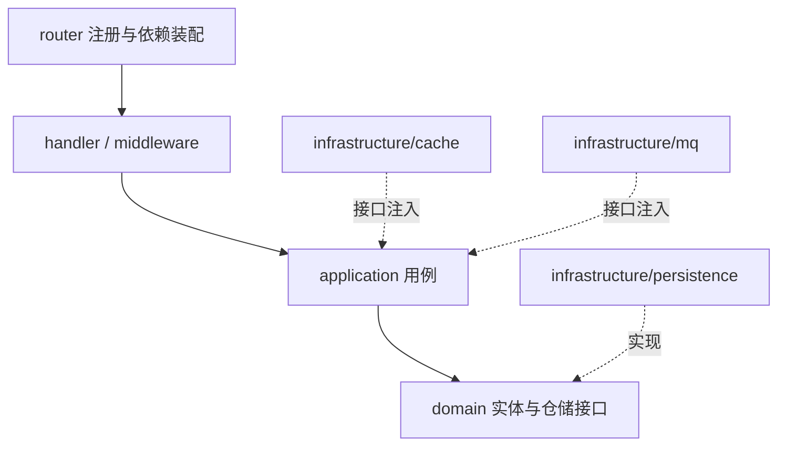
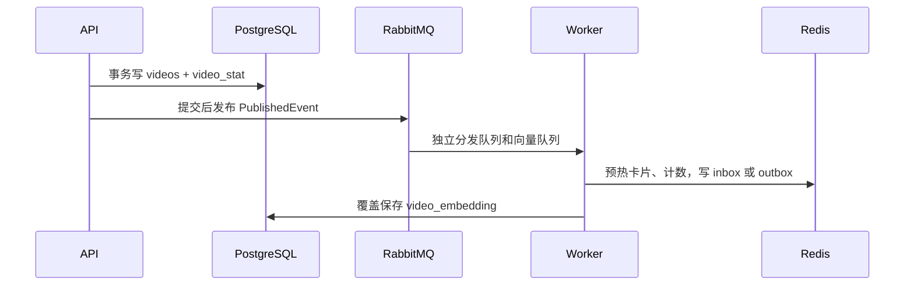

# VideoFeed 系统架构

当前由 Go API、独立 worker、React Web、PostgreSQL、Redis 和 RabbitMQ 组成。产品状态见 [产品范围](product.md)，详细边界见 [模块索引](modules/README.md)，运行方式见 [部署说明](deployment.md)。

## 1. 系统上下文

Web 开发端口 5173；生产 Nginx 代理 `/api/` 和 `/uploads/`。上传使用本地目录/Compose 数据卷，对象存储和 CDN 是规划能力。API 提供 `/health`；worker 不提供 HTTP 健康接口。

## 2. 分层与装配

配置、数据库、JWT 分别在 `internal/config`、`internal/database`、`internal/auth/jwt`。包名和构造函数沿用所在模块；账户代码模块为 `user`。API 的 `internal/router/register.go` 与 `cmd/worker/main.go` 共用 `internal/infrastructure/persistence/migration.AutoMigrate`，事务级 PostgreSQL 咨询锁防止并发启动迁移竞争。

## 3. 核心请求链路

### 注册和登录

用户 handler → application/user → domain/user → 用户仓储。bcrypt 保存密码，JWT 签发访问令牌；退出登录由客户端清除令牌，不使用撤销黑名单。

### 视频发布与分发

发布幂等重放不重复发消息。粉丝不足 10000 的作者每批向 500 个粉丝 inbox 推送；大作者只写 outbox，关注流读取合并。消息与数据库不在同一事务，没有可靠发件箱或发布确认；投递失败不回滚视频。

### Feed 读取

`GET /api/feed-items` 与 `POST /api/feed/query` 注册 timeline/hot/following/recommend 策略。Timeline 使用游标页缓存、singleflight、批量卡片和计数读取。Hot 配置 Redis 时使用一小时窗口，窗口读取失败返回错误；未配置缓存时使用数据库累计热度。Following 合并索引并核验关注和发布状态，不足或故障时回源。Recommend 使用近三十天观看与文本向量排序，排除近七天曝光，按推荐次序复用卡片组装，不缓存个性化页。Following/Recommend 必须登录。

### 互动与观看行为

点赞/收藏异步路径：Redis WATCH 用户行为键→事务更新状态及 16 分片计数→发布 ActionChangedEvent→worker 幂等写 PostgreSQL。Redis 失败返回错误；MQ 失败同步写仓储。评论与计数同步事务写入。热度更新为尽力而为。

曝光上报：JWT 用户→同步事务写 `video_view_events`→exposed 时原子累加 `exposures`→尽力发布画像事件。`request_id` 不提供重试幂等。画像消费接口存在，但当前 worker 没有启动画像消费者。

关注保存后，小作者近期最多 100 条作品同步回填 inbox；中途失败返回错误但关系已提交，显式重试复用原幂等键。

## 4. 数据模型

| 数据表 | 主要事实与约束 |
| --- | --- |
| users | 账号唯一、密码哈希、资料与状态 |
| videos | 视频状态、作者、发布时间；作者+幂等键唯一；时间线复合索引 |
| video_stat | 视频主键，点赞/评论/收藏计数 |
| interaction_action | 用户+视频+行为唯一，保存当前状态 |
| interaction_action_idempotency | 用户+行为类型+幂等键唯一，保留响应快照 |
| interaction_comment | 评论及软删除状态，用户+幂等键唯一 |
| user_follow | 用户+目标用户唯一，关注软状态 |
| user_relation_stat | 用户主键，关注数和粉丝数 |
| user_follow_idempotency | 用户+幂等键唯一，关系响应快照 |
| feed_inbox | 保留历史表，当前分发读取改用 Redis 索引 |
| video_view_events | 曝光/播放/完播/跳过流水 |
| exposures | 用户+视频唯一，首次/最近曝光与累计次数 |
| video_embedding | 视频+模型复合主键，同模型原子覆盖向量和文本哈希 |

字段、时间类型、状态值、索引与事务细节以各模块 `model.go`、仓储及 [模块文档](modules/README.md) 为准。新表统一加入迁移入口，不能遗漏幂等表。

## 5. 部署与故障边界

Compose 六服务与四个持久卷沿用 `docker-compose.yaml`。API/worker 等待 PostgreSQL、Redis、RabbitMQ 健康，Web 等待 API 健康；worker 的取消、连接关闭和重启边界见部署说明。

MQ 成功逐条确认，非法 JSON 拒绝且不重新入队，处理失败重新入队；当前无退避、自动重连或死信重放。数据库失败不隐式放行，Redis 回源策略依场景区分；不能把局部事务等同于跨资源原子性。

## 6. 规划边界

播放参数、预加载与 QoS 已由 `internal/application/playback`、`internal/infrastructure/persistence/playback` 和 `internal/handler/playback` 实现，使用 `playback_config` 与 `playback_qos_log`，详情见 [播放模块](modules/playback.md)。审核、后台运营、通用限流与降级开关、监控告警尚未实现。规划模块文档保留接口与数据设计，但不写入已实现 OpenAPI。进一步性能方案见 [优化专题](optimization.md)，历史迁移与真实服务证据见 [迁移记录](migrations.md)。
