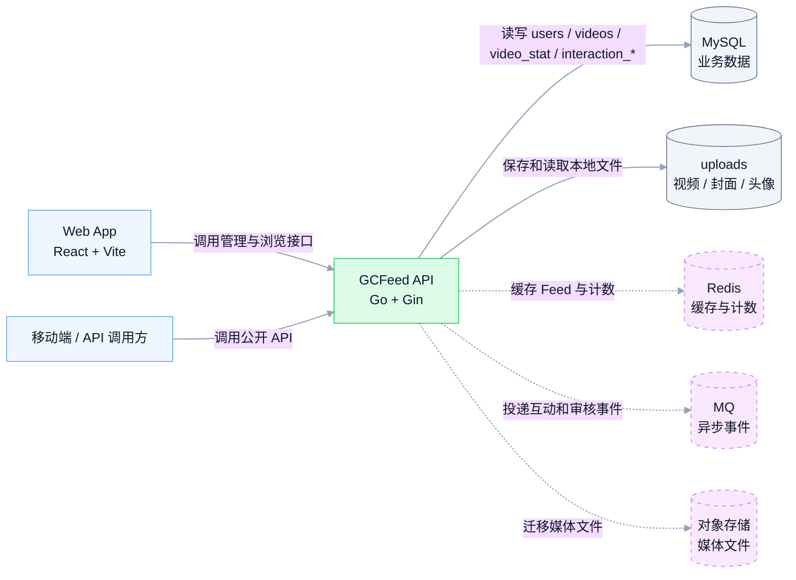
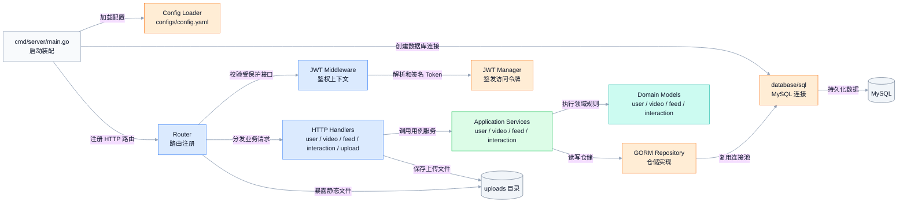
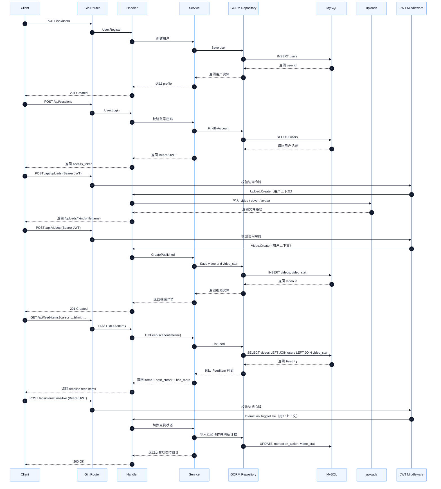
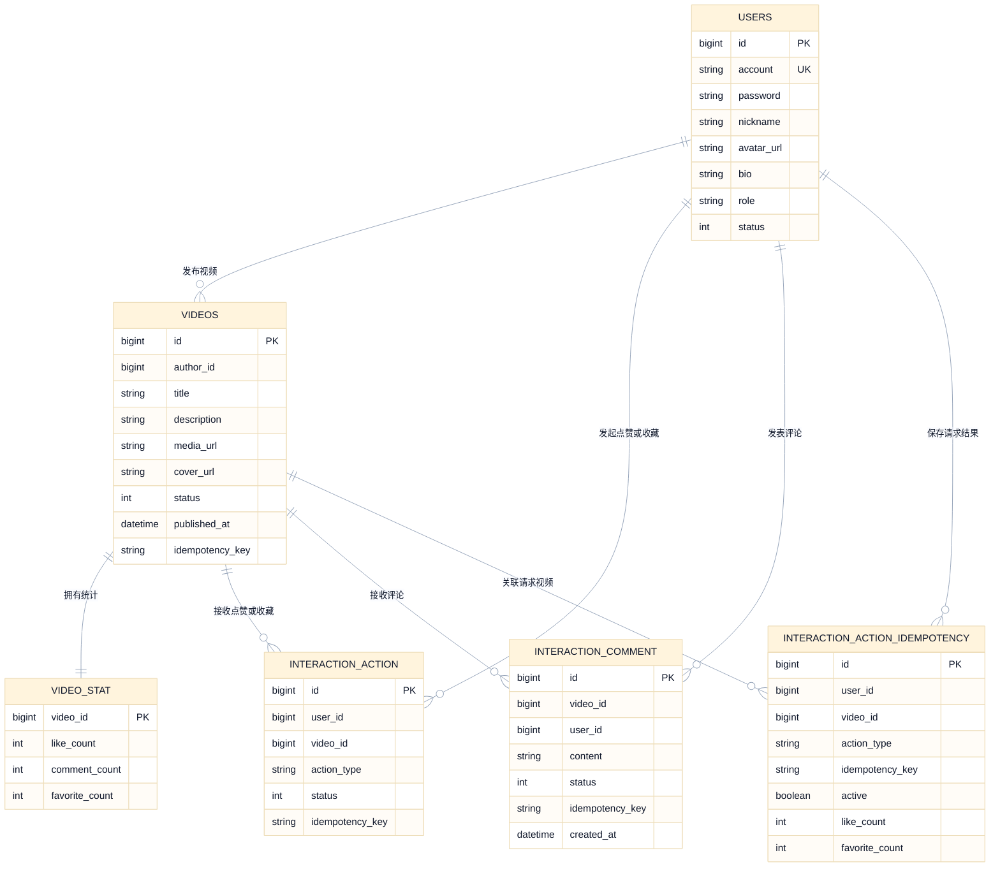
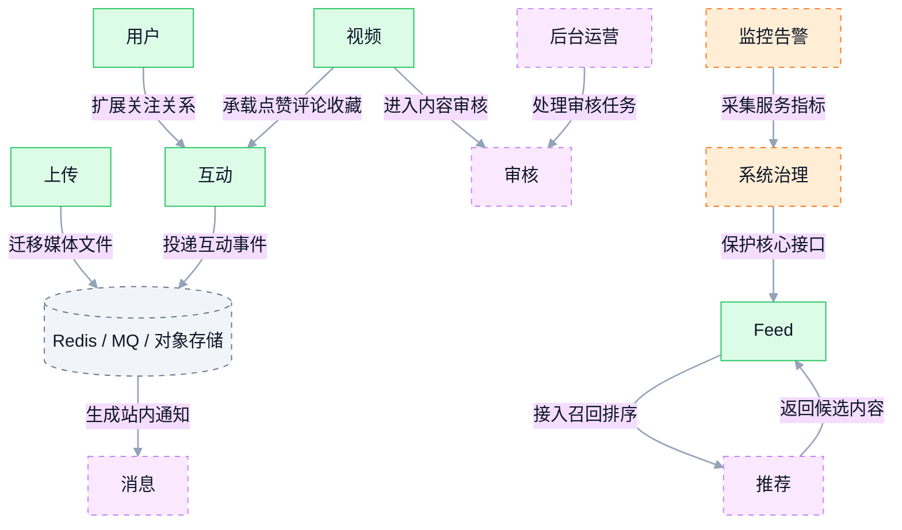

# 视频 Feed 系统架构图（MVP）

本文描述当前视频 Feed 系统的实现边界与演进方向。Go API 以单体方式承载用户、视频、Feed、互动与上传能力；Redis、消息队列和对象存储仍属于后续演进范围。

## 1. 系统上下文

这张图展示 GCFeed 与客户端、存储和演进型基础设施的边界。

## 2. API 内部分层

这张图展示 Go API 单体内部的主要代码层次和依赖方向。

## 3. 核心请求链路

这张图展示注册、登录、上传、发布、刷 Feed 与互动的核心请求链路。上传、发布和互动请求都需要携带 Bearer JWT。

## 4. 数据模型

这张图展示当前 GORM 自动迁移的数据表及业务关联。关联用于表达业务关系；当前持久化模型未声明数据库外键约束。

## 5. 演进能力地图

这张图展示已落地闭环和后续模块的连接方式，虚线代表规划中的能力边界。

## 6. 说明

- 当前代码以 Go API 单体承载用户、视频、Feed、互动与上传能力，内部按接口层、应用层、领域层、基础设施层组织。
- 业务接口统一挂载在 `/api/*`；互动接口为 `/api/interactions/*` 与 `/api/comments`。静态文件通过 `/uploads/*` 访问，健康检查使用 `/health`。
- 数据持久化使用 MySQL，GORM 自动迁移 `users`、`videos`、`video_stat`、`interaction_action`、`interaction_action_idempotency` 与 `interaction_comment` 表。
- Feed 当前采用 Timeline 策略，按 `published_at DESC, id DESC` 排序，并通过 Base64 游标分页。
- 推荐、审核、消息、治理和监控模块作为演进边界保留；已落地的互动模块后续可接入异步事件和独立服务。

